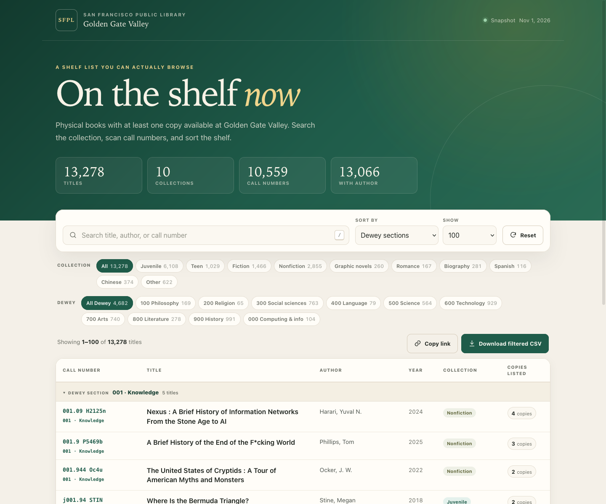

# Golden Gate Valley shelf list

A searchable, sortable snapshot of physical books with at least one copy
available at San Francisco Public Library's Golden Gate Valley branch.



The static site is plain HTML, CSS, and JavaScript. It has no build step and no
runtime dependencies. Open `index.html` directly, or serve the folder:

```sh
python3 -m http.server 8000
```

Then visit <http://localhost:8000>.

## Snapshot

- **Branch:** Golden Gate Valley (`G6`), San Francisco Public Library
- **Snapshot date:** 2026-11-01
- **Titles:** 13,278
- **Unique call numbers:** 10,559
- **Titles with an author:** 13,066
- **Dewey-labeled titles:** 4,682 across 387 sections

## What "available" means

Each row is a title with at least one copy available at Golden Gate Valley at
the time of collection. Availability comes from the classic catalog's
branch-scoped browse with the "Limit to available" filter.

The **copies listed** number counts all copy rows shown for a title, including
copies that may be checked out. It is not a live count of available copies.

This is a reading aid, not an official circulation record. Some reference or
non-circulating items may appear. Check the library catalog for exact,
current copy status.

## Dewey browsing

Nonfiction call numbers are parsed to the first three-digit Dewey Decimal
Classification (DDC 23) section, after shelf prefixes such as `J`, `TEEN`, and
`SPANISH`. For example, `006.3` maps to section 006, *Special computer methods*,
within division 000, *Computer science, knowledge & systems*.

The interface provides class and division filter chips, section links on each
row, and a **Dewey sections (000–999)** sort that inserts collapsible section
headers, groups DDC-numbered rows in section order, and places non-DDC rows
afterward. Sections start collapsed. Dewey labels are a browsing aid adapted
from publicly available DDC 23
summaries; unassigned numbers fall back to the division label. DDC is a trademark of OCLC. This project is
independent and is not endorsed by OCLC or San Francisco Public Library.

## Files

| File | Purpose |
| --- | --- |
| `index.html` | Page shell and static UI |
| `styles.css` | Responsive layout, print styles |
| `app.js` | Search, collection and Dewey filters, sorting, pagination, CSV export |
| `ddc.js` | Dewey class, division, and section captions |
| `data.js` | Generated browser dataset (`window.G6_META`, `window.G6_BOOKS`) |
| `build_data.py` | Converts the CSV into `data.js` |
| `sfpl_g6_available.py` | Public-catalog collector |
| `sfpl_g6_available.csv` | Full snapshot with provenance columns |

## Rebuild the web data

From this directory:

```sh
python3 build_data.py
```

By default it reads `sfpl_g6_available.csv` and writes `data.js` next to the
script. Both paths can be overridden:

```sh
python3 build_data.py path/to/input.csv path/to/data.js
```

## Re-collect the data

The collector uses only public, read-only catalog pages. It sends one request
at a time with a polite delay by default, and does not use library accounts or
authentication.

```sh
# Quick partial test: call numbers starting with 0
python3 sfpl_g6_available.py --prefixes 0 --out g6_0.csv

# One multi-character prefix
python3 sfpl_g6_available.py --prefixes j0 --out g6_j0.csv

# Full sweep
python3 sfpl_g6_available.py --out sfpl_g6_available.csv
```

A full sweep takes a while because the classic catalog is page-oriented and
metadata enrichment is batched. Use `--delay` to be gentler, `--max-pages` for
a deliberately partial run, and `--held-count` to check the new catalog's
held-at-branch count without collecting rows.

### Why two catalogs?

The new BiblioCommons catalog can enumerate every bib held at the branch, but
its search API does not expose a branch-availability facet. Copy-level status is
available only one bib at a time. The classic catalog exposes the
available-at-branch subset directly, but lacks structured author metadata.

The collector therefore harvests available shelf rows from the classic catalog,
then enriches them in batches with BiblioCommons call-number queries. Rows that
cannot be matched fall back to the classic catalog's title statement and are
marked `legacy` in `metadata_source`.

## CSV columns

| Column | Meaning |
| --- | --- |
| `title` | Book title |
| `author` | Author, when available |
| `call_number` | Shelf call number used for browsing |
| `catalog_call_number` | Call number from the enriched catalog record, when different |
| `format` | Material format; currently `Book` |
| `availability` | `AT_LEAST_ONE_COPY_AVAILABLE_AT_BRANCH` |
| `copies_listed_at_branch` | All copy rows shown for the title, including checked-out copies |
| `branch` | `GOLDEN GATE VALLEY BRANCH` |
| `year` | Publication year, when available |
| `metadata_source` | `bibliocommons` or `legacy` |

The in-browser CSV export adds computed `ddc_code`, `ddc_class`,
`ddc_division`, and `ddc_section` columns. The snapshot CSV itself keeps the
original provenance columns shown above.

## Notes and limitations

- Availability is a point-in-time snapshot, not a live feed.
- Collection labels are derived from call-number ranges and are approximate.
- Dewey labels are derived from the leading three-digit section of a call
  number; prefixed, fiction, biography, and other non-DDC call numbers are left
  unlabeled. Unassigned DDC numbers use the division caption as a fallback.
- The classic browse returns title-level availability; individual copy status
  can change independently.
- A small number of titles may not match a new-catalog record. These retain
  classic-catalog metadata and are marked as `legacy`.
- This project is not affiliated with or endorsed by San Francisco Public
  Library.

## Publishing

The repository is designed to work as a GitHub Pages site: deploy from the
`main` branch and the repository root.
